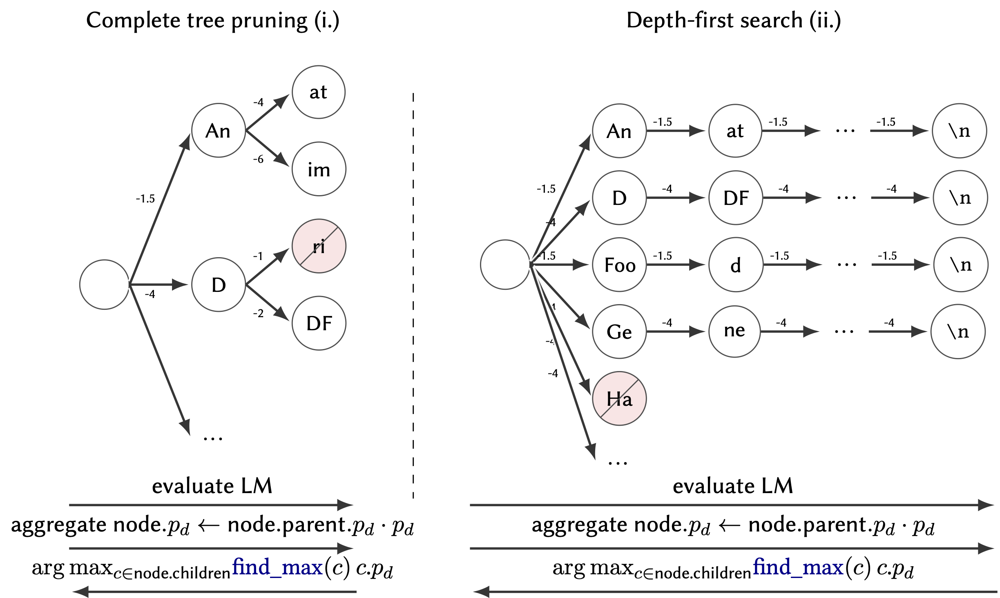

# CHASTE

[](https://doi.org/10.5281/zenodo.20313871)
[](LICENSE)

CHASTE (Constrained Holistic Annotator System with onTological Entities) is the code behind *CHASTE: Constrained Holistic Annotator System with onTological Entities*, the TU Graz (team ToGS) entry to the GutBrainIE task of the BioASQ Lab, presented at CLEF 2026 (Working Notes, CEUR-WS).
The repository also holds our 2025 entry, CLEANR (*Constrained Linked Entity ANnotation using RAG*, [CLEF 2025 Working Notes](https://ceur-ws.org/Vol-4038/paper_23.pdf)).

[PDF](https://dakantz.at/papers/2026/chaste/paper.pdf) · [Appendix with the complete result tables](appendix.pdf)



> **Research use only. Not a medical device.** See [DISCLAIMER.md](DISCLAIMER.md) for intended use, data provenance and limitations.

## Overview

CHASTE extracts entities and relations from PubMed titles and abstracts on the gut-brain axis, following the GutBrainIE task schema (13 entity labels, 25 predicates, concept URIs). The pipeline

1. splits title and abstract into sentences;
2. detects candidate entity spans with spaCy (`en_core_web_hftrf`) or a fine-tuned BERT token tagger;
3. builds a GBNF grammar per sentence from the candidate spans and the task's entity and relation labels;
4. generates the annotations with a grammar-constrained Hermes 3 model (Llama 3.2 3B or Llama 3.1 8B, optionally LoRA fine-tuned) through `llama-cpp-python`, optionally with retrieved training examples (RAG, `NeuML/pubmedbert-base-embeddings`) and with the constrained beam search from [`beam-search/`](beam-search/README.md) (published on PyPI as `llama-cpp-beam-search`);
5. parses the output and links entities to concept URIs by exact and TF-IDF matching against the training annotations.

A naive lookup baseline (exact matches of training-set entities) can run on its own or enrich the grammar. All models run locally; the only outside service is the Hugging Face Hub, from which base models and embedding models are downloaded. No LLM API is called.

## Data

The [GutBrainIE](https://hereditary.dei.unipd.it/challenges/gutbrainie/2026/) dataset (PubMed titles and abstracts with expert, student and distantly supervised annotations) is distributed by the task organisers after registration to the BioASQ Lab; we found no licence that allows redistribution. It is **not** in the repository: request it from the organisers and place it under `data/Annotations/` (`Train/`, `Dev/`) and `data/Articles/json_format/`.

The repository contains only `data/bionner/dev_relations.tsv`, a relation list derived from the [NEREL-BIO](https://github.com/nerel-ds/NEREL-BIO) development set, and the official result tables in `submission/results_test/`. Trained model weights are not released.

## Running locally

There is no Docker image. You need `uv`, Python 3.13, a C/C++ toolchain (and CUDA or Metal for GPU inference), and a Hugging Face account with access to the gated `meta-llama` tokenizers.

```sh
git submodule update --init --recursive
CMAKE_ARGS="-DGGML_CUDA=on -DCMAKE_BUILD_PARALLEL_LEVEL=8" uv sync --prerelease=allow
# you might need to set your CUDA architecture:
# CMAKE_BUILD_PARALLEL_LEVEL=8 CMAKE_ARGS="-DGGML_CUDA=on -DCMAKE_CUDA_ARCHITECTURES=75" uv sync --prerelease=allow
# on Apple silicon:
# CMAKE_ARGS="-DGGML_METAL=on" uv sync --prerelease=allow
source .venv/bin/activate
```

Download the base models (set your Hugging Face token first, e.g. with `huggingface-cli login`) and convert them to GGUF in `quants/`:

```sh
tune download NousResearch/Hermes-3-Llama-3.2-3B --output-dir models/hermes-3-2-3B
huggingface-cli download meta-llama/Llama-3.2-3B original/tokenizer.model --local-dir models/hermes-3-2-3B
tune download NousResearch/Hermes-3-Llama-3.1-8B --output-dir models/hermes-3-1-8B
huggingface-cli download meta-llama/Llama-3.1-8B original/tokenizer.model --local-dir models/hermes-3-1-8B
python manage_models/quantize_all.py
```

Optionally fine-tune LoRA adapters (configs in `configs/`, output in `finetunes/`) and run `python manage_models/quantize_all.py` again to convert them:

```sh
python manage_models/lora_finetune_single_device.py --config configs/hermes-3B-lora-entities.yaml
python manage_models/lora_finetune_single_device.py --config configs/hermes-3B-lora-relations.yaml
```

Prepare the retrieval index from the training collection (writes `data/Annotations/prepared_train.json`) and annotate a set of articles:

```sh
python prepare.py
python inference.py --model-spec quants/hermes-3-2-3B.gguf --type entities \
  --data-path data/Annotations/prepared_train.json \
  --eval-path data/Articles/json_format/articles_dev.json \
  --out-path data/results_dev --out-file hermes-3-2-3B-entities.json --add-naive
```

`--add-rag`, `--beam-search end|shallow`, `--naive-only` and `--use-ne-finetuned` select the pipeline variants of the paper; `--use-ne-finetuned` needs a fine-tuned tagger in `finetuned/ned/best_model_pubmed/` (see `finetune_ned.ipynb`). The `slurm/` scripts run the full evaluation grid; the notebooks in `submission/` evaluate and merge runs and build the tables.

## Citation

```bibtex
@inproceedings{kantz2026chaste,
  title     = {{CHASTE}: Constrained Holistic Annotator System with onTological Entities},
  author    = {Kantz, Benedikt and Waldert, Peter and Lengauer, Stefan and Schreck, Tobias},
  booktitle = {CLEF 2026 Working Notes},
  series    = {CEUR Workshop Proceedings},
  publisher = {CEUR-WS.org},
  year      = {2026},
  url       = {https://dakantz.at/papers/2026/chaste/paper.pdf}
}

@software{kantz2026chaste_software,
  author    = {Kantz, Benedikt},
  title     = {{Dakantz/CHASTE: GutbrainIE Submission}},
  version   = {submission-licensed},
  year      = {2026},
  publisher = {Zenodo},
  doi       = {10.5281/zenodo.20313871},
  url       = {https://doi.org/10.5281/zenodo.20313871}
}
```

## Acknowledgement

<picture>
  <source media="(prefers-color-scheme: dark)" srcset="figures/funded-by-the-eu-dark.png">
  
</picture>

Funded by the European Union under grant agreement No 101137074 ([HEREDITARY](https://hereditary-project.eu/)).
Views and opinions expressed are however those of the author(s) only and do not necessarily reflect those of the European Union or the European Health and Digital Executive Agency (HaDEA).
Neither the European Union nor the granting authority can be held responsible for them.

## License

MIT, see [LICENSE](LICENSE).
